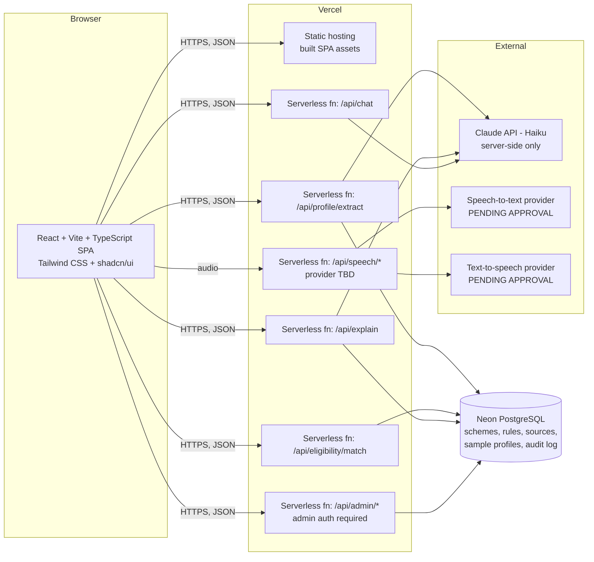
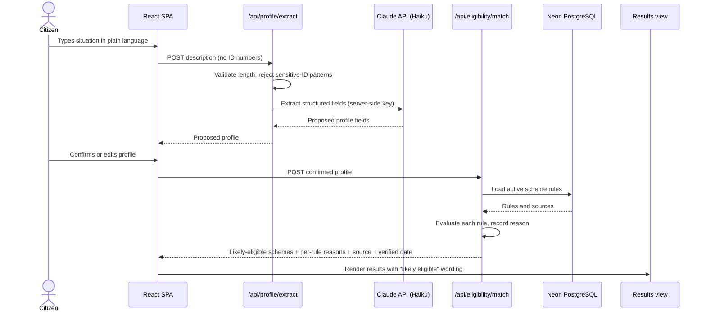

# ClaimSaathi – Architecture

Status: Foundation document. Implementation NOT started. Stack is fixed by project decision; provider choices marked PENDING are not yet approved.

## 1. System overview

ClaimSaathi is a single-page React application served from Vercel, backed by protected Vercel serverless functions that talk to Neon PostgreSQL and to third-party AI/speech APIs. **There is no Spring Boot, no Express server, and no separate long-running backend.** Browser code never holds API keys.

## 2. Component diagram

## 3. Layer responsibilities

| Layer | Technology | Responsibility |
|---|---|---|
| Frontend | React, Vite, TypeScript | Pages, plain-language input, results, checklists, admin UI |
| Styling / UI kit | Tailwind CSS, shadcn/ui | Layout, accessible components, consistent look |
| Serverless API | Vercel functions (TypeScript) | Validate input, call AI/speech providers, query DB, enforce auth and rate limits |
| Database | Neon PostgreSQL | Scheme records, rules as data, source URLs, verification dates, sample profiles |
| AI | Claude API (Haiku), server-side | Bilingual chat, profile extraction from text, plain-language explanations |
| Speech | Provider TBD (STT and TTS) | Voice input and output, regional language |
| Hosting | Vercel | Static SPA plus serverless functions |

## 4. Frontend

- React + Vite + TypeScript single-page app.
- Tailwind CSS for styling; shadcn/ui for component primitives (copied into the repo, not a runtime dependency on a remote service).
- Routes (planned): public landing, about, disclaimer; citizen flow (describe, confirm profile, results, scheme detail, checklist, guide); admin area.
- The SPA never imports secret values; it only calls `/api/*` routes.

## 5. Protected serverless functions

- All AI, speech, database-write, and admin operations go through Vercel serverless functions.
- Each function:
  - validates request shape and length limits;
  - rejects fields that look like Aadhaar or other sensitive ID numbers;
  - applies rate limiting (mechanism PENDING: Vercel/Neon option not yet verified);
  - returns only the fields the UI needs.
- Secrets (Claude key, speech keys, Neon connection string) live in Vercel environment variables only.

## 6. Claude API integration (server-side only)

- Model: Haiku, per the AI agent description in the project configuration. Exact model identifier: PENDING VERIFICATION.
- Used for three purposes only:
  1. **Profile extraction:** turn a plain-language description into structured fields, shown to the user for confirmation.
  2. **Bilingual chat:** answer questions about the process in English or a regional language.
  3. **Explanations:** rewrite the rule-based match reasons in plain language.
- Eligibility decisions come from stored rules in the database, not from the model alone. The model explains; rules decide.
- Pricing and rate limits: PENDING VERIFICATION (not in research files).

## 7. Speech-to-text and text-to-speech (pluggable)

- Both are behind a single internal interface in a serverless function, so the provider can be swapped.
- Candidates named in research (none approved):
  - STT: Sarvam Saaras v4 (te-IN); Bhashini; IndicConformer-600M (self-host candidate).
  - TTS: Sarvam Bulbul v4 Flash; Indic Parler-TTS (self-host candidate); Bhashini.
- Deprecated per research: Saarika (listed as deprecated by the dossiers).
- Free-tier or credit figures: PENDING VERIFICATION.
- Audio is processed transiently; retention policy PENDING APPROVAL.

## 8. Data model (high level)

| Entity | Purpose |
|---|---|
| `schemes` | Scheme name, level (central/state), category, description, status |
| `scheme_rules` | Editable eligibility rules: field, operator, value, human-readable text |
| `scheme_sources` | Official source URL, publisher, verified-on date, verifier |
| `scheme_documents` | Document requirements per scheme |
| `scheme_steps` | Application steps per scheme |
| `sample_profiles` | Synthetic test profiles only |
| `admin_users` | Admin accounts (auth method PENDING APPROVAL) |
| `audit_log` | Admin edits to rules and sources |

Exact schema: not yet designed.

## 9. Data flow

### 9.1 Sequence: plain-language input to likely-eligible results

### 9.2 Data movement rules

- Raw description text is sent to the model only for extraction and explanation, not stored by default (retention PENDING APPROVAL).
- Rule evaluation is deterministic code over database rules.
- Results shown to the user carry the scheme source link and last-verified date.

## 10. Security boundaries

| Boundary | Control |
|---|---|
| Browser to server | HTTPS only; no secrets in the bundle; CORS limited to app origin |
| Secrets | Vercel environment variables only; never in client code or logs |
| Sensitive IDs | No Aadhaar or ID-number fields; server rejects matching input patterns |
| Database access | Neon connection used only from serverless functions; RLS policies planned for user-owned data (design PENDING) |
| Public read | Scheme and rule read endpoints are public and read-only |
| Admin | Admin routes require authentication (method PENDING APPROVAL); edits written to audit log |
| Rate limits | Applied on AI, speech and profile routes (mechanism PENDING) |
| Test data | Sample profiles only; no real citizen data in development |

## 11. Explicitly out of architecture

- Spring Boot, Express, FastAPI, PydanticAI, LangGraph, Next.js, Supabase: not part of this project (rejected; see TECH_DECISIONS.md).

## 12. Open items

- Speech provider choice and free-tier verification
- Neon and Vercel free-tier limits
- Claude pricing and model identifier check
- Rate-limit mechanism
- Admin authentication method
- Database schema and RLS design
