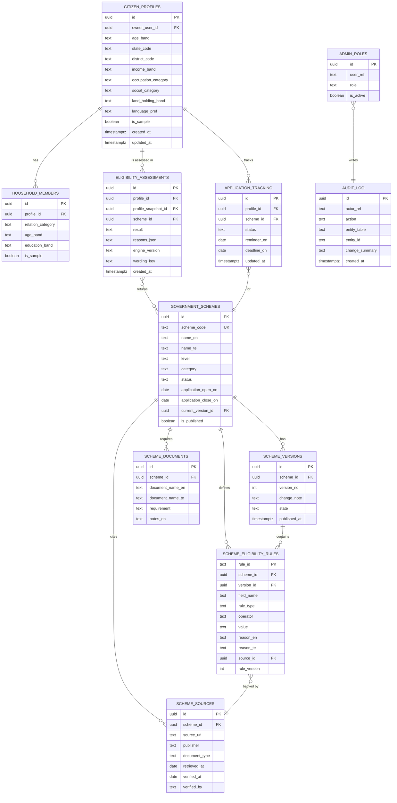

# ClaimSaathi – Database Schema (Neon PostgreSQL)

**Status: PROPOSED – NOT APPROVED.** Every table, section and column in this document is proposed. Nothing here is implemented or migrated. Agent 05 (data/backend) reviews before any DDL is written.

Related: ARCHITECTURE.md §8 (high-level entities, names mapped in §10 below), PROJECT_BRIEF.md §8 (guardrails).

## 1. Design principles – PROPOSED – NOT APPROVED

- **No Aadhaar, no ID numbers, anywhere.** No column, index, log field or audit payload may hold an Aadhaar number, PAN, voter ID, ration card number, phone or bank account number.
- **Coarse answers only.** Citizen profiles store bands and categories (e.g. age band, income band), not exact values where a band is enough.
- **Rules are data.** Eligibility rules live in `scheme_eligibility_rules`; no rule logic is hard-coded in application code.
- **Public scheme data, private profile data.** Scheme tables are public-read. Profile tables are owner-only.
- **Every scheme fact has a source and dates.** Each rule and scheme row traces to a `scheme_sources` row with `verified_at`.
- **Test data = sample profiles only.** Synthetic profiles are flagged `is_sample = true`.
- **Schema names are PROPOSED** and may be renamed by agent 05 to match ARCHITECTURE.md §8.

## 2. Entity overview – PROPOSED – NOT APPROVED

## 3. Tables – PROPOSED – NOT APPROVED

### 3.1 citizen_profiles

Owner-only. Holds coarse answers only.

| Column | Type | Notes |
|---|---|---|
| id | uuid PK | |
| owner_user_id | uuid FK | Auth user; NULL allowed for anonymous session profiles (PENDING APPROVAL) |
| age_band | text | e.g. `under_18`, `18_25`, `26_40`, `41_60`, `60_plus` (bands PROPOSED) |
| state_code | text | `AP` for MVP; central schemes apply by state |
| district_code | text | AP district code (source list PENDING VERIFICATION) |
| income_band | text | Band labels PROPOSED; thresholds live in rules, not here |
| occupation_category | text | Category list PROPOSED (e.g. farmer, daily_wage, student, homemaker, self_employed, other) |
| social_category | text | Category list PENDING VERIFICATION against scheme rules |
| land_holding_band | text | e.g. `none`, `small`, `medium`, `large` (bands PENDING VERIFICATION) |
| language_pref | text | `en` or `te` |
| is_sample | boolean | `true` for synthetic test profiles only |
| created_at, updated_at | timestamptz | |

**Explicitly absent:** Aadhaar, any ID number, name, phone, email, exact address, exact income, bank details.

### 3.2 household_members

| Column | Type | Notes |
|---|---|---|
| id | uuid PK | |
| profile_id | uuid FK → citizen_profiles | ON DELETE CASCADE |
| relation_category | text | e.g. spouse, child, parent (category list PROPOSED) |
| age_band | text | Same bands as profile |
| education_band | text | Used for scholarship rules; bands PENDING VERIFICATION |
| is_sample | boolean | |

No member names, no member identifiers.

### 3.3 government_schemes

| Column | Type | Notes |
|---|---|---|
| id | uuid PK | |
| scheme_code | text UNIQUE | Stable internal code |
| name_en, name_te | text | Bilingual names; Telugu may be PENDING TRANSLATION REVIEW |
| level | text | `central` or `state` |
| category | text | e.g. scholarship, pension, farm, health, housing, employment |
| status | text | `open`, `closed`, `not_yet_open`, `unknown` |
| application_open_on, application_close_on | date | NULL when not published |
| current_version_id | uuid FK → scheme_versions | |
| is_published | boolean | Only published schemes are public |

### 3.4 scheme_versions

| Column | Type | Notes |
|---|---|---|
| id | uuid PK | |
| scheme_id | uuid FK | |
| version_no | int | Monotonic per scheme |
| change_note | text | Admin-entered summary |
| state | text | `draft`, `published`, `superseded` |
| published_at | timestamptz | |

### 3.5 scheme_eligibility_rules

One row = one rule. The match engine evaluates these; the model never decides.

| Column | Type | Notes |
|---|---|---|
| rule_id | text PK | Human-readable, e.g. `AP-PEN-001-R03` (format PROPOSED) |
| scheme_id | uuid FK | |
| version_id | uuid FK → scheme_versions | Rule belongs to one version |
| field_name | text | Must match a profile field name from §3.1 or §3.2 |
| rule_type | text | `threshold`, `category`, `flag`, `age_range`, `location` (set PROPOSED) |
| operator | text | `eq`, `neq`, `in`, `lte`, `gte`, `between` (set PROPOSED) |
| value | text | Stored as text; parsed by engine by rule_type |
| reason_en, reason_te | text | Plain-language reason shown to user |
| source_id | uuid FK → scheme_sources | Required; no rule without a source |
| rule_version | int | Incremented on each edit |

### 3.6 scheme_sources

| Column | Type | Notes |
|---|---|---|
| id | uuid PK | |
| scheme_id | uuid FK | |
| source_url | text | Official URL only (G.O., portal, or notified news) |
| publisher | text | e.g. state department name |
| document_type | text | `GO`, `portal`, `news` (G.O. = Government Order) |
| retrieved_at | date | When the source was fetched |
| verified_at | date | When a person confirmed the rule against it |
| verified_by | text | Admin reference, not personal ID |

### 3.7 scheme_documents (document checklists)

| Column | Type | Notes |
|---|---|---|
| id | uuid PK | |
| scheme_id | uuid FK | |
| document_name_en, document_name_te | text | Bilingual |
| requirement | text | `mandatory` or `optional` |
| notes_en | text | e.g. "self-attested copy accepted" – only if sourced |

### 3.8 scheme_steps (application guidance)

Not in the requested list but referenced by ARCHITECTURE.md §8. Proposed columns: `id`, `scheme_id`, `step_no`, `text_en`, `text_te`, `official_link_id` (FK to scheme_sources).

### 3.9 eligibility_assessments

Result of one matching run. Stores reasons, never identity data.

| Column | Type | Notes |
|---|---|---|
| id | uuid PK | |
| profile_id | uuid FK | |
| profile_snapshot_id | uuid | Points to an immutable copy of the confirmed profile at run time (table PROPOSED) |
| scheme_id | uuid FK | |
| result | text | `likely_eligible`, `not_likely_eligible`, `needs_more_info` |
| reasons_json | jsonb | List of `{rule_id, matched, reason_key}`; no free-text user input |
| engine_version | text | Version of deterministic engine |
| wording_key | text | Selects the approved "likely eligible" wording; never "guaranteed" |
| created_at | timestamptz | |

Retention of assessments: PENDING APPROVAL.

### 3.10 application_tracking (future)

| Column | Type | Notes |
|---|---|---|
| id | uuid PK | |
| profile_id | uuid FK | |
| scheme_id | uuid FK | |
| status | text | `not_started`, `in_progress`, `submitted`, `closed` (PROPOSED) |
| reminder_on | date | Reminder date chosen by user |
| deadline_on | date | From scheme or user-entered |
| updated_at | timestamptz | |

Application reference numbers must NOT be stored in this MVP (may be ID-like).

### 3.11 admin_roles

| Column | Type | Notes |
|---|---|---|
| id | uuid PK | |
| user_ref | text | Reference to auth provider user (method PENDING APPROVAL) |
| role | text | `viewer`, `editor`, `publisher` (PROPOSED) |
| is_active | boolean | |

### 3.12 audit_log

Append-only. Written by serverless functions on every admin write.

| Column | Type | Notes |
|---|---|---|
| id | uuid PK | |
| actor_ref | text | Admin reference |
| action | text | `create`, `update`, `publish`, `verify_source` |
| entity_table | text | |
| entity_id | text | |
| change_summary | text | Summary only; must not contain citizen data |
| created_at | timestamptz | |

## 4. Row-level security – PROPOSED – NOT APPROVED

| Table | anon | authenticated citizen | admin | service role |
|---|---|---|---|---|
| citizen_profiles | none | SELECT/INSERT/UPDATE/DELETE where `owner_user_id = auth.uid()` | none (PROPOSED: no read of citizen data) | used only inside serverless functions |
| household_members | none | via owning profile only | none | serverless only |
| government_schemes | SELECT where `is_published` | SELECT where `is_published` | INSERT/UPDATE | serverless only |
| scheme_versions, scheme_eligibility_rules, scheme_sources, scheme_documents, scheme_steps | SELECT where parent scheme published | same | INSERT/UPDATE; publish via function | serverless only |
| eligibility_assessments | none | SELECT own rows | none | INSERT |
| application_tracking | none | own rows only | none | serverless only |
| admin_roles | none | none | SELECT own role | serverless only |
| audit_log | none | none | SELECT (PROPOSED) | INSERT only |

Rules that apply everywhere:
- The **service role key is never sent to the browser**; it exists only in Vercel environment variables used by serverless functions.
- No policy may expose `is_sample = false` profile data to another user.
- Admins do not get a blanket read of citizen profiles (PROPOSED; to be confirmed).
- Every table with user data has RLS enabled; RLS verification method PENDING VERIFICATION.

## 5. Aadhaar and sensitive-ID controls – PROPOSED – NOT APPROVED

- No column named or typed to hold Aadhaar, PAN, voter ID, ration card, phone, email, or bank data (see §3.1).
- Serverless input validation rejects 12-digit number patterns and similar ID-like strings before any write.
- Sensitive-ID patterns are not written to `audit_log` or application logs.
- A schema review checklist item: "grep migrations for Aadhaar|aadhaar|uid|UID – must be empty."

## 6. Indexes and constraints – PROPOSED

- Unique: `government_schemes.scheme_code`; `(scheme_id, version_no)` on `scheme_versions`.
- FK indexes on every `*_id` column used in joins.
- `scheme_eligibility_rules`: check `source_id IS NOT NULL`.
- `scheme_sources`: check `verified_at >= retrieved_at` when both set.
- Partial index on `government_schemes (is_published)`.

## 7. Migration and sample data – PROPOSED

- Migrations kept in repo under a folder PENDING APPROVAL (location not yet decided).
- Seed data: synthetic sample profiles (`is_sample = true`) and sample schemes only. Real scheme facts are seeded only after source verification.
- Neon free-tier storage and connection limits: PENDING VERIFICATION.

## 8. Mapping to ARCHITECTURE.md names

| ARCHITECTURE.md §8 | This document |
|---|---|
| schemes | government_schemes |
| scheme_rules | scheme_eligibility_rules |
| scheme_sources | scheme_sources |
| scheme_documents | scheme_documents |
| scheme_steps | scheme_steps (§3.8) |
| sample_profiles | citizen_profiles with `is_sample = true` (PROPOSED) |
| admin_users | admin_roles |
| audit_log | audit_log |

## 9. Open questions for agent 05

1. Should `sample_profiles` remain a separate table, or be `citizen_profiles` with `is_sample`? (Proposed: flag.)
2. Confirm auth provider and how `owner_user_id` / `user_ref` are populated – method PENDING APPROVAL.
3. Are anonymous (no-login) profile sessions allowed for the MVP? If yes, how is RLS applied without `auth.uid()`?
4. Confirm the band lists and thresholds for income, land and age against scheme sources.
5. Confirm `rule_type` and `operator` sets; can they cover every rule in the AP and central source documents?
6. Should `eligibility_assessments` be stored at all for the MVP, or computed on the fly? Retention PENDING APPROVAL.
7. Is a `scheme_steps` table approved, and where do official application links live?
8. Confirm the sensitive-ID validation pattern list and where it runs (function level only, or also DB constraint).
9. Confirm how `profile_snapshot_id` is stored (separate snapshot table not yet listed).
10. Confirm Neon free-tier limits (PENDING VERIFICATION) before sizing history tables.
