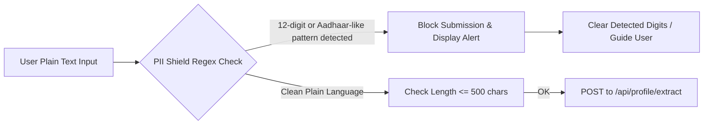

# ClaimSaathi – Frontend Architecture Specification

**Status:** APPROVED ARCHITECTURAL SPECIFICATION  
**Target:** React 18+ / Vite / TypeScript / Tailwind CSS / shadcn/ui  
**Owner:** Agent 03 (Frontend_Architect)  
**Related Documents:** [ARCHITECTURE.md](file:///d:/Hackathon/PS5/ClaimSaathi/ARCHITECTURE.md), [TECH_DECISIONS.md](file:///d:/Hackathon/PS5/ClaimSaathi/TECH_DECISIONS.md), [DESIGN_SYSTEM.md](file:///d:/Hackathon/PS5/ClaimSaathi/DESIGN_SYSTEM.md), [USER_FLOWS.md](file:///d:/Hackathon/PS5/ClaimSaathi/USER_FLOWS.md), [DATABASE_SCHEMA.md](file:///d:/Hackathon/PS5/ClaimSaathi/DATABASE_SCHEMA.md)

---

## 1. Executive Summary & Architectural Principles

ClaimSaathi is a citizen-first welfare navigation single-page application (SPA) focused on Andhra Pradesh residents. It enables citizens to describe their real-world circumstances in plain language (English or Telugu) and immediately receive:
1. **Likely-eligible schemes** backed by deterministic, rule-by-rule explanations.
2. **Personalised document checklists** with mandatory and optional requirements.
3. **Step-by-step application guidance** with verified official government portal links.

### Core Architectural Guardrails
1. **Zero Client-Side Secrets:** Browser code communicates exclusively with protected Vercel serverless functions (`/api/*`). No Claude API keys, Neon connection strings, or speech service credentials ever touch the client bundle.
2. **Strict PII Shielding:** The frontend strictly prohibits the collection of Aadhaar numbers, PAN cards, bank account numbers, or exact street addresses. A client-side regex pre-sanitizer intercepts and blocks any 12-digit number sequence before network dispatch.
3. **Coarse Categorisation:** Citizen data is gathered and handled in coarse bands (e.g. age bands, income brackets, land holding categories), minimizing privacy surface area.
4. **Deterministic Eligibility vs. AI Explanation:** AI (Claude Haiku server-side) is strictly used for profile extraction and natural language rewriting. Eligibility matching is 100% deterministic, calculated against verified database rules.
5. **Always Grounded & Verified:** Every scheme and result displays its official primary source link and a "last verified on [date]" tag or an explicit "PENDING VERIFICATION" notice.
6. **Multilingual by Design:** English, Telugu, and Hindi are first-class citizens with instant toggling, localized typography (+4px line height compensation for Telugu script, +2px for Devanagari Hindi script), and accessible screen-reader tags (`lang="en"`, `lang="te"`, `lang="hi"`).

---

## 2. Technology Stack & Decision Matrix

| Layer | Chosen Technology | Rationale | Alternatives Evaluated & Rejected |
|---|---|---|---|
| **Core Framework** | React 18+ / Vite / TypeScript (Strict) | Instant HMR, minimal bundle overhead, static deployment on Vercel CDN, strict type contracts. | Next.js (rejected: SSR complexity unnecessary for static client + serverless); Spring Boot / Express (rejected: project rules forbid standalone backends). |
| **Styling & Design System** | Tailwind CSS + shadcn/ui (Radix UI primitives) | Utility-first styling, zero-runtime CSS, fully accessible WAI-ARIA compliant unstyled primitives copied directly into source repository. | Material UI / Ant Design (rejected: heavy runtime overhead, harder custom government theme); Bootstrap (rejected). |
| **Client State Management** | Zustand | Ultra-lightweight (~1kB), hook-based, zero-boilerplate state store for multi-step onboarding, profile cache, and filter criteria. | Redux Toolkit (rejected: excessive boilerplate); React Context alone (rejected: unnecessary re-renders in multi-step wizard). |
| **Server State & Data Fetching** | TanStack Query v5 (React Query) | Declarative caching, background refetching, automatic retry logic, loading/error state isolation for `/api/*` endpoints. | Raw `useEffect` + `fetch` (rejected: brittle cache invalidation and race conditions). |
| **Routing** | React Router v6 | Declarative client-side routing, nested layout support, scroll restoration, route protection guards. | TanStack Router (considered, but React Router v6 has standard shadcn/ui integration). |
| **Form Handling & Validation** | React Hook Form + Zod | Minimal re-renders, performant uncontrolled inputs, declarative schemas, unified PII regex validation rules. | Formik (rejected: performance on complex multi-step fields). |
| **Icons** | Lucide React | Clean, tree-shakeable SVG icon set natively matched with shadcn/ui. | Material Icons (rejected: bundle weight). |
| **Typography** | Noto Sans Telugu + Noto Sans Devanagari + Inter | Open-source typography optimized for legible rendering of complex Telugu ligatures, Devanagari Hindi script, and English text. | System fonts alone (rejected: inconsistent Indic font fallback across Android/Windows). |

---

## 3. Comprehensive Directory Layout (`src/`)

```
src/
├── assets/                       # Static media, emblems, logos
│   ├── images/
│   │   ├── logo-claimsaathi.svg  # Official logo mark
│   │   └── hero-illustration.svg # Plain language welfare illustration
│   └── icons/                    # Custom iconography if needed
│
├── components/                   # React presentation and container components
│   ├── ui/                       # shadcn/ui primitives (Radix UI based)
│   │   ├── alert.tsx
│   │   ├── accordion.tsx
│   │   ├── badge.tsx
│   │   ├── button.tsx
│   │   ├── card.tsx
│   │   ├── checkbox.tsx
│   │   ├── dialog.tsx
│   │   ├── input.tsx
│   │   ├── label.tsx
│   │   ├── progress.tsx
│   │   ├── radio-group.tsx
│   │   ├── select.tsx
│   │   ├── skeleton.tsx
│   │   ├── tabs.tsx
│   │   ├── textarea.tsx
│   │   └── toast.tsx
│   │
│   ├── common/                   # Global shared UI components
│   │   ├── Header.tsx            # App bar with navigation & language toggle
│   │   ├── Footer.tsx            # Source disclosure, disclaimers, links
│   │   ├── LanguageToggle.tsx    # Instant EN <-> TE switcher
│   │   ├── DisclaimerBanner.tsx  # "Likely eligible" statutory notice banner
│   │   ├── SampleProfileBanner.tsx # Visual reminder when synthetic demo profile is active
│   │   ├── VerificationBadge.tsx # "Verified on [date]" / "PENDING VERIFICATION" badge
│   │   ├── SourceFooter.tsx      # Official government portal reference link & metadata
│   │   └── PiiAlertBanner.tsx    # Live warning when 12-digit numbers are typed
│   │
│   ├── citizen/                  # Citizen onboarding & description components
│   │   ├── PlainTextInput.tsx    # Free-text situation input area with PII shield
│   │   ├── VoiceInputModal.tsx   # Speech-to-text recording modal (graceful fallback)
│   │   ├── ProfileConfirmForm.tsx# Review and adjust coarse band chips/dropdowns
│   │   ├── ClarifyingQuestions.tsx # Step-by-step modal for max 3 missing profile attributes
│   │   └── HouseholdMemberForm.tsx # Coarse dependent selector (age band, student status)
│   │
│   ├── eligibility/              # Eligibility results & reasoning cards
│   │   ├── ResultGroupHeader.tsx # Likely Eligible / Need More Info / Ineligible headers
│   │   ├── SchemeResultCard.tsx  # Scheme overview card with status and match summary
│   │   ├── RuleReasonCard.tsx    # Per-rule breakdown (Rule, Condition, Citizen Data, Match)
│   │   ├── MissingInfoList.tsx   # Actionable "Add this detail" trigger list
│   │   └── EligibilityFilterBar.tsx # Filter by Central vs State, Category, Status
│   │
│   ├── scheme/                   # Scheme detail, checklist, application guides
│   │   ├── SchemeHero.tsx        # Title, official authority, level, last verified
│   │   ├── DocumentChecklist.tsx # Interactive client-side document checkboxes with print
│   │   ├── ApplicationStepList.tsx # Sequenced roadmap of application steps
│   │   └── OfficialLinkBox.tsx   # Prominent primary portal link with external indicator
│   │
│   └── admin/                    # Admin portal components
│       ├── AdminNav.tsx          # Admin tabs (Schemes, Rules, Sources, Audit Log)
│       ├── SchemeForm.tsx        # Scheme metadata editor
│       ├── RuleEditorTable.tsx   # Editable rules table (field, operator, value, reason)
│       └── SourceVerifyModal.tsx # Record G.O. / portal verification metadata
│
├── config/                       # Application configuration and static taxonomy
│   ├── routes.ts                 # Centralized route paths and navigation config
│   ├── bands.ts                  # Standardized coarse bands (income, age, land, caste)
│   ├── constants.ts              # Global limits (e.g. 500 char limit, regex patterns)
│   └── env.ts                    # Safe runtime environment variable assertions
│
├── hooks/                        # Custom reusable React hooks
│   ├── useLanguage.ts            # Active language state, translation helper
│   ├── usePiiShield.ts           # Real-time regex validator detecting 12-digit patterns
│   ├── useEligibility.ts         # Query hook wrapping `/api/eligibility/match`
│   ├── useProfileExtract.ts      # Mutation hook wrapping `/api/profile/extract`
│   ├── useSpeechRecorder.ts      # Audio capture and STT streaming abstraction
│   └── usePrintChecklist.ts      # Trigger browser print with formatted stylesheet
│
├── layouts/                      # Layout wrappers
│   ├── RootLayout.tsx            # Main shell (Header, DisclaimerBanner, Outlet, Footer)
│   ├── CitizenFlowLayout.tsx     # Progress stepper layout for Onboarding -> Results
│   └── AdminLayout.tsx           # Authenticated admin frame with sidebar/tabs
│
├── locales/                      # Trilingual translation dictionaries
│   ├── en/                       # English dictionaries
│   │   ├── common.json           # Navigation, buttons, generic alerts
│   │   ├── onboarding.json       # Describe, confirm profile, clarifying questions
│   │   ├── eligibility.json      # Results, rule match explanations, reasons
│   │   └── scheme.json           # Documents, steps, portal guidance
│   ├── te/                       # Telugu dictionaries (తెలుగు)
│   │   ├── common.json
│   │   ├── onboarding.json
│   │   ├── eligibility.json
│   │   └── scheme.json
│   └── hi/                       # Hindi dictionaries (हिन्दी)
│       ├── common.json
│       ├── onboarding.json
│       ├── eligibility.json
│       └── scheme.json
│
├── pages/                        # Routable views
│   ├── public/
│   │   ├── HomePage.tsx          # Public landing page with service overview & quick start
│   │   ├── AboutPage.tsx         # Data provenance, methodology, project background
│   │   ├── DisclaimerPage.tsx    # Full legal disclaimer and statutory boundaries
│   │   ├── NotFoundPage.tsx      # Accessible 404 handler
│   │   └── NotAuthorizedPage.tsx # 403 access control handler for admin routes
│   ├── citizen/
│   │   ├── DescribePage.tsx      # Step 1: Plain-language text/voice input
│   │   ├── ConfirmProfilePage.tsx# Step 2: Confirm extracted coarse profile
│   │   ├── ResultsPage.tsx       # Step 3: Categorized scheme matches & rule explanations
│   │   └── SchemeDetailPage.tsx  # Step 4: Full scheme view (Rules, Documents, Steps)
│   └── admin/
│       ├── AdminDashboardPage.tsx# Scheme list, verification status overview
│       ├── AdminSchemeEditPage.tsx # Scheme detail & rule editing suite
│       └── AdminAuditLogPage.tsx # Read-only view of rule modification audit trail
│
├── services/                     # Typed client-side API connectors
│   ├── apiClient.ts              # Base fetch wrapper with timeout and error normalization
│   ├── profileApi.ts             # Calls `/api/profile/extract`
│   ├── eligibilityApi.ts         # Calls `/api/eligibility/match` and `/api/explain`
│   ├── schemeApi.ts              # Calls `/api/schemes` and `/api/schemes/:id`
│   └── adminApi.ts               # Calls `/api/admin/*`
│
├── store/                        # Global reactive client state (Zustand)
│   ├── useProfileStore.ts        # Confirmed profile, synthetic demo profile toggles
│   ├── useAssessmentStore.ts     # Current assessment result cache, filter preferences
│   └── useLanguageStore.ts       # Active language ('en' | 'te') and persistence
│
├── types/                        # Core TypeScript domain models & contracts
│   ├── profile.ts                # ProfileBands, CitizenProfile, HouseholdMember
│   ├── scheme.ts                 # Scheme, SchemeRule, SchemeSource, SchemeDocument, Step
│   ├── eligibility.ts            # AssessmentResult, RuleEvaluation, MatchStatus
│   ├── api.ts                    # API request / response contracts
│   └── i18n.ts                   # Strongly-typed translation keys
│
└── utils/                        # Pure utility functions
    ├── piiValidator.ts           # Aadhaar / 12-digit / phone regex detection
    ├── formatters.ts             # Currency, date (DD Mon YYYY), and number formatting
    ├── ruleExplainer.ts          # Rule operator humanizer (gte -> "at least", etc.)
    └── cn.ts                     # ClassName merger (clsx + tailwind-merge)
```

---

## 4. State Management Architecture

```mermaid
flowchart TD
    subgraph UI_Components [React UI Components]
        DP[DescribePage]
        CP[ConfirmProfilePage]
        RP[ResultsPage]
        SDP[SchemeDetailPage]
    end

    subgraph Zustand_Stores [Client Global Stores (Zustand)]
        PS[ProfileStore<br/>• profile: CitizenProfile<br/>• isSample: boolean<br/>• rawInput: string]
        AS[AssessmentStore<br/>• results: AssessmentResult[]<br/>• activeFilter: FilterCriteria<br/>• expandedSchemeId: string]
        LS[LanguageStore<br/>• language: 'en' | 'te'<br/>• setLanguage: fn]
    end

    subgraph TanStack_Query [Server State Cache (TanStack Query)]
        QP[useMutation: /api/profile/extract]
        QM[useQuery: /api/eligibility/match]
        QS[useQuery: /api/schemes/:id]
    end

    subgraph Serverless_API [Protected Serverless Layer]
        API_EXTRACT[/api/profile/extract]
        API_MATCH[/api/eligibility/match]
        API_SCHEMES[/api/schemes]
    end

    DP -->|1. Types Situation| PS
    DP -->|2. Submits| QP
    QP -->|3. POST payload| API_EXTRACT
    API_EXTRACT -->|4. Extracted Profile| QP
    QP -->|5. Populate| PS

    CP -->|6. Confirms Profile| PS
    PS -->|7. Confirmed Profile| QM
    QM -->|8. POST Profile| API_MATCH
    API_MATCH -->|9. Evaluation & Reasons| QM
    QM -->|10. Hydrate Results| AS

    RP -->|Reads Results| AS
    SDP -->|Reads Scheme Detail| QS
    QS -->|GET Scheme| API_SCHEMES
    UI_Components -->|Reads Language| LS
```

### Store Responsibilities

1. **`useProfileStore`:**
   - Holds the ephemeral user input (max 500 characters).
   - Holds the proposed profile and confirmed profile attributes.
   - Flags `isSample: boolean` (set to `true` when pre-filled with demo scenarios A, B, or C).
   - Does **not** persist sensitive personal identity data into `localStorage`. Only non-identifying coarse bands exist in memory.
2. **`useAssessmentStore`:**
   - Holds the array of evaluated schemes returned by `/api/eligibility/match`.
   - Manages active UI filters (Central Schemes, AP State Schemes, Categories: Scholarship, Pension, Farm, Health, Housing).
   - Tracks missing profile attributes required for partial matches.
3. **`useLanguageStore`:**
   - Stores current UI language preference (`'en'`, `'te'`, or `'hi'`).
   - Persisted in `localStorage` under `claimsaathi_lang` for convenience.
   - Triggers an instant DOM update setting `document.documentElement.lang = language`.

---

## 5. Client-Side Security & PII Protection Engine

Strict compliance with Problem Statement 5 Guardrails mandates that **no Aadhaar or sensitive identification data may enter the system**. The frontend implements a multi-tiered defense:



### PII Shield Implementation Rules (`src/utils/piiValidator.ts`)
1. **12-Digit Interception:** Matches any continuous 12-digit string or 4-4-4 formatted digit group (`\b\d{4}[ -]?\d{4}[ -]?\d{4}\b`).
2. **10-Digit Phone / PAN Interception:** Matches standard Indian mobile prefixes (`\b[6-9]\d{9}\b`) and PAN structures (`\b[A-Z]{5}[0-9]{4}[A-Z]{1}\b`).
3. **Immediate Reactive Warning:** As soon as an ID-like pattern is detected:
   - The "Check Eligibility" submit action is completely disabled.
   - A high-visibility `PiiAlertBanner` renders: *"Please do not type ID numbers such as Aadhaar, PAN, or phone numbers. Describe your situation instead (e.g., 'I am a 65-year-old widow living in Guntur')."*
   - The detected numeric string is stripped or the citizen is given a one-click "Clear Number" action.
4. **No Identity Columns:** The client-side TypeScript types have zero fields for names, phone numbers, email addresses, or document ID numbers.

---

## 6. Multilingual Localization (English, Telugu & Hindi) Architecture

### Design Philosophy
Welfare schemes must be natively accessible to citizens across regional languages. Localization covers English, Telugu, and Hindi, built into every presentation component.

```
+---------------------------------------------------------------------------------+
| ClaimSaathi / క్లెయిమ్ సాథీ / क्लेम साथी       [🌐 English | తెలుగు | हिन्दी]     |
+---------------------------------------------------------------------------------+
|  English String:   "Likely eligible for 3 schemes"                              |
|  Telugu String:    "మీరు 3 పథకాలకు అర్హత పొందే అవకాశం ఉంది"                     |
|  Hindi String:     "आप 3 योजनाओं के लिए पात्र हो सकते हैं"                     |
+---------------------------------------------------------------------------------+
```

### Typography and Font Rules
- **English Font:** `Inter`, `Noto Sans`, system-ui.
- **Telugu Font:** `Noto Sans Telugu`, system-ui, sans-serif.
- **Hindi Font:** `Noto Sans Devanagari`, system-ui, sans-serif.
- **Line-Height Compensation:**
  - In Telugu script, vowel modifiers (matras) and conjunct consonants require vertical clearance. The CSS architecture injects `.font-telugu` with `line-height: calc(1.5em + 4px)`.
  - In Devanagari (Hindi) script, upper diacritics and the headline (shirorekha) require `.font-hindi` with `line-height: calc(1.5em + 2px)` to prevent clipping.
- **Dynamic Language Tagging:** When localized strings are rendered, elements are tagged with `lang="en"`, `lang="te"`, or `lang="hi"`, ensuring screen readers (e.g. TalkBack, NVDA) automatically switch to the correct phonetic synthesizer.

---

## 7. Routing and Navigation Matrix

| Route Path | View Component | Access Level | Layout Wrapper | Purpose |
|---|---|---|---|---|
| `/` | `HomePage` | Public | `RootLayout` | Service explanation, "likely eligible" notice, primary start CTA. |
| `/about` | `AboutPage` | Public | `RootLayout` | Data provenance, list of official government portals, methodology. |
| `/disclaimer` | `DisclaimerPage` | Public | `RootLayout` | Statutory notice: not an official sanction, preliminary assessment only. |
| `/describe` | `DescribePage` | Citizen | `CitizenFlowLayout` | Plain-language typed or spoken situation intake. |
| `/confirm-profile` | `ConfirmProfilePage` | Citizen | `CitizenFlowLayout` | Review coarse attributes, answer up to 3 clarifying questions. |
| `/results` | `ResultsPage` | Citizen | `CitizenFlowLayout` | Categorized match results with deterministic rule explanations. |
| `/schemes/:schemeId` | `SchemeDetailPage` | Citizen | `RootLayout` | Scheme details, source link, last verified date, document checklist. |
| `/admin` | `AdminDashboardPage` | Admin (Protected) | `AdminLayout` | Scheme management dashboard, verification status monitor. |
| `/admin/schemes/:id` | `AdminSchemeEditPage`| Admin (Protected) | `AdminLayout` | Visual rule and source editor. |
| `/admin/audit-log` | `AdminAuditLogPage` | Admin (Protected) | `AdminLayout` | Read-only audit trail of scheme and rule modifications. |
| `/not-authorized` | `NotAuthorizedPage` | Public | `RootLayout` | 403 fallback for non-admin attempts. |
| `*` | `NotFoundPage` | Public | `RootLayout` | 404 fallback. |

---

## 8. API Client Contract & Data Flow

Client services interact with serverless handlers through strongly-typed request and response boundaries:

### 1. Profile Extraction Contract (`POST /api/profile/extract`)
```typescript
// Request
export interface ExtractProfileRequest {
  text: string;                  // Plain language description (max 500 characters)
  language: 'en' | 'te' | 'hi';  // Language of input
}

// Response
export interface ExtractProfileResponse {
  proposed_profile: {
    age_band?: 'under_18' | '18_25' | '26_40' | '41_60' | '60_plus';
    state_code: 'AP';
    district_code?: string;
    income_band?: 'below_1_2L' | '1_2L_to_2_5L' | '2_5L_to_5L' | 'above_5L';
    occupation_category?: 'farmer' | 'daily_wage' | 'student' | 'homemaker' | 'self_employed' | 'other';
    social_category?: 'OC' | 'BC' | 'SC' | 'ST' | 'minority';
    land_holding_band?: 'none' | 'marginal_under_2_5_acres' | 'small_2_5_to_5_acres' | 'large_above_5_acres';
    household_members?: Array<{
      relation: 'spouse' | 'child' | 'parent';
      age_band: string;
      education_band?: 'primary' | 'class_10' | 'intermediate' | 'graduate';
    }>;
  };
  missing_critical_fields: string[]; // e.g. ['income_band', 'social_category']
  clarifying_questions: Array<{
    field_name: string;
    question_en: string;
    question_te: string;
    question_hi: string;
    options: Array<{ value: string; label_en: string; label_te: string; label_hi: string }>;
  }>;
}
```

### 2. Eligibility Evaluation Contract (`POST /api/eligibility/match`)
```typescript
// Request
export interface MatchEligibilityRequest {
  confirmed_profile: CitizenProfile;
  is_sample: boolean;
}

// Response
export interface MatchEligibilityResponse {
  assessment_id: string;
  evaluated_at: string;
  results: {
    likely_eligible: SchemeMatchResult[];
    needs_more_info: SchemeMatchResult[];
    not_likely_eligible: SchemeMatchResult[];
  };
}

export interface SchemeMatchResult {
  scheme_id: string;
  scheme_code: string;
  name_en: string;
  name_te: string;
  name_hi: string;
  level: 'central' | 'state';
  category: 'scholarship' | 'pension' | 'farm' | 'health' | 'housing' | 'employment';
  status: 'open' | 'closed' | 'not_yet_open';
  benefit_summary_en: string;
  benefit_summary_te: string;
  benefit_summary_hi: string;
  official_source_url: string;
  verified_at: string | null;      // ISO date or null
  is_verified: boolean;            // false if pending verification
  matched_rules: Array<{
    rule_id: string;
    field_name: string;
    condition_description_en: string;
    condition_description_te: string;
    condition_description_hi: string;
    user_value_description_en: string;
    user_value_description_te: string;
    user_value_description_hi: string;
    status: 'matched' | 'not_matched' | 'unknown';
    reason_en: string;
    reason_te: string;
    reason_hi: string;
  }>;
  missing_fields: string[];        // fields that caused "needs_more_info"
}
```

---

## 9. Accessibility (WCAG 2.2 AA) & Performance Guardrails

1. **Touch Targets:** All interactive buttons, tabs, select menus, and checkboxes enforce a minimum clickable bounding box of **44 × 44 pixels**.
2. **Keyboard Trapping & Focus Rings:** Every interactive element has an explicit, high-contrast focus ring (`focus-visible:ring-2 focus-visible:ring-offset-2 focus-visible:ring-[#0B5FFF]`). Dialogs and modals trap focus while open.
3. **Screen Reader Live Regions:** Eligibility match calculation progress, profile extraction spinners, and error toasts use `aria-live="polite"` and `role="status"` to announce updates to assistive technologies without stealing focus.
4. **Color Contrast:** All text pairings satisfy a minimum contrast ratio of 4.5:1 against their background (3:1 for large headings and input borders). Status is **never communicated by color alone**—every badge pairs a color with a distinct icon and explicit text label.
5. **Print Stylesheet:** Document checklists and application guides include dedicated `@media print` CSS rules that remove navigational headers/footers and render a clean, high-contrast, black-and-white printable checklist for the citizen.
6. **Performance Budget:** Initial JavaScript bundle size target is `< 180 kB` gzipped by leveraging Vite's dynamic code splitting for admin views and route components.

---

## 10. Summary of Architectural Guarantees

| Requirement | Implementation in Frontend Architecture |
|---|---|
| **Problem Statement 5 Guardrails** | "Likely eligible" terminology everywhere; zero Aadhaar/PII collection; client-side 12-digit regex interceptor; synthetic demo banner. |
| **Grounding & Transparency** | Per-rule breakdown rendered in expandable card; official government URL and verification date attached to every scheme. |
| **No Complex Backends** | Pure static React/Vite SPA hosted on Vercel CDN; all logic routed to minimal protected serverless functions. |
| **Citizen-First UX** | Plain-language input, low cognitive load (max 3 clarifying questions), bilingual EN/TE support, printable document checklist. |
